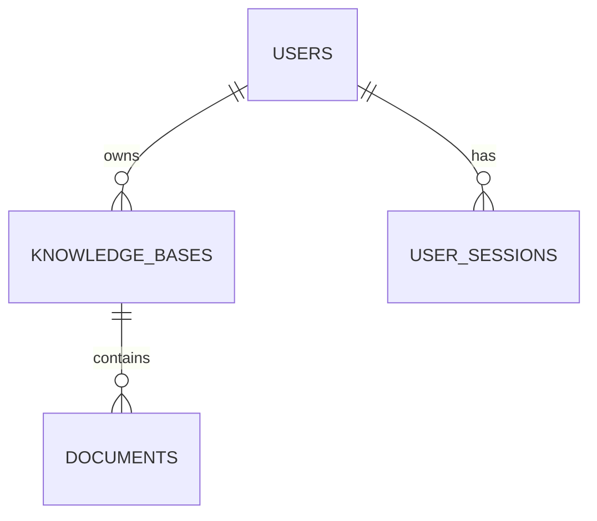

# 第一阶段详细设计：用户、知识库与文档

状态：持续维护中的设计；初稿 2026-11-02，更新 2026-11-04。用户、会话和知识库模型已创建；文档及清理任务仍为计划。接口状态以本文件第 5 节为准。

## 1. 约定与假设

- 单用户拥有多个知识库；第一阶段不支持共享、角色管理、重名用户或文档版本管理。
- 使用邮箱和密码注册；邮箱规范化为去除首尾空格并转小写后再唯一校验。当前已开放自助注册。
- 标识符采用 UUID，时间采用 PostgreSQL `timestamptz`（存储为 UTC）；API 时间使用 ISO 8601。
- 文档原文件暂存服务器本地，数据库只保存存储键，不保存文件二进制。
- 当前 API 没有统一前缀，以下路径反映当前约定；前端与 API 分别运行，本地前端直接访问 `http://localhost:3000`，通过 CORS 携带 Cookie。是否统一引入 `/api` 属于后续契约调整，变更时前后端和 Cookie 路径须一起迁移。
- 文件上限为 50 MiB/个（52,428,800 字节），允许 PDF、MD、DOC、DOCX。实际格式校验和预览能力按文件类型区分。

## 2. 数据关系

同一用户下知识库名称默认不可重复；不同用户可使用相同名称。同一知识库允许上传同名文件，文档 ID 和服务端生成的存储键区分它们。知识库名称去除首尾空格，长度和唯一性在服务端校验；唯一性区分大小写，若将来需要忽略大小写须调整约束并迁移数据。

## 3. 表结构

约定：以下为逻辑数据库设计，最终 Prisma 字段命名与数据库映射可分别使用 camelCase 和 snake_case。时间字段由应用统一维护或数据库生成，具体以迁移实现为准。

### 3.1 users：用户

| 字段 | PostgreSQL 类型 | 必填 | 约束 / 说明 |
| --- | --- | --- | --- |
| id | uuid | 是 | 主键；服务端生成 |
| email | varchar(254) | 是 | 规范化后**唯一**；用于登录 |
| password_hash | text | 是 | 密码的单向哈希，绝不存明文或返回给前端 |
| display_name | varchar(50) | 是 | 显示名称；注册时提供 |
| created_at | timestamptz | 是 | 创建时间，默认当前时间 |
| updated_at | timestamptz | 是 | 信息更新时维护 |

唯一索引：`email`。密码使用成熟的密码哈希算法（如 Argon2id）及库；不自行实现加密算法。

### 3.2 knowledge_bases：知识库

| 字段 | PostgreSQL 类型 | 必填 | 约束 / 说明 |
| --- | --- | --- | --- |
| id | uuid | 是 | 主键 |
| owner_id | uuid | 是 | 外键 → `users.id`；所属用户 |
| name | varchar(100) | 是 | 去除首尾空格后非空 |
| description | varchar(500) | 否 | 可选描述，未填写为 null |
| status | varchar(20) | 是 | `active`、`deleting`；默认 `active` |
| created_at | timestamptz | 是 | 创建时间 |
| updated_at | timestamptz | 是 | 修改时间 |

唯一约束：`(owner_id, name)`，包括清理中的知识库，以避免名称冲突；索引：`(owner_id, created_at)`。用户删除功能暂不提供，外键采用 `RESTRICT`，避免绕过文件清理。

### 3.3 user_sessions：长期登录会话

长期登录由短期 access token 和可撤销的长期 refresh token 共同实现。下列期限是可配置的初始设计值，非用户指定的固定期限。

| 字段 | PostgreSQL 类型 | 必填 | 约束 / 说明 |
| --- | --- | --- | --- |
| id | uuid | 是 | 主键，会话标识 |
| user_id | uuid | 是 | 外键 → `users.id`，用户拥有此会话 |
| refresh_token_hash | varchar(128) | 是 | 随机 refresh token 的哈希值，不存明文 |
| expires_at | timestamptz | 是 | 会话绝对过期时间，初始建议 30 天 |
| revoked_at | timestamptz | 否 | 会话撤销时间；null 表示未主动撤销 |
| created_at | timestamptz | 是 | 创建时间 |
| updated_at | timestamptz | 是 | token 轮换时间 |

索引：`user_id`、`expires_at`；外键采用 `RESTRICT`。每次登录创建独立会话，过期或退出后不可再刷新。定期清理过期/已撤销会话；用户删除功能加入时需先撤销并清理会话。

### 3.4 documents：文档

| 字段 | PostgreSQL 类型 | 必填 | 约束 / 说明 |
| --- | --- | --- | --- |
| id | uuid | 是 | 主键 |
| knowledge_base_id | uuid | 是 | 外键 → `knowledge_bases.id` |
| original_name | varchar(255) | 是 | 原文件名，仅展示用途，不用作物理路径 |
| storage_key | varchar(255) | 是 | 服务端生成的相对存储键，**唯一** |
| file_extension | varchar(10) | 是 | 小写 `pdf`、`md`、`doc`、`docx` |
| media_type | varchar(127) | 否 | 服务端识别结果或可信的规范化类型；MD 等无法可靠识别时可为空 |
| size_bytes | bigint | 是 | 文件字节数；大于 0，不超过配置上限 |
| status | varchar(20) | 是 | `uploaded`、`deleting`；默认 `uploaded`，不表示已解析 |
| created_at | timestamptz | 是 | 上传记录创建时间 |
| updated_at | timestamptz | 是 | 状态更新时间 |

唯一约束：`storage_key`；索引：`(knowledge_base_id, created_at)`；外键采用 `RESTRICT`，删除知识库时先处理其文档。可用数据库 CHECK 约束限制状态及文件大小。`bigint` 在 JSON 中以十进制字符串返回，避免 JavaScript 精度问题。

`status` 表示第一阶段文件管理状态；后续解析状态及失败信息将在任务模型明确后设计，不把 `uploaded` 当作 AI 索引完成。无数据库级联删除文件。

### 3.5 file_cleanup_tasks：文件清理任务

文件删除可能失败且无法加入数据库事务，因此使用持久化清理任务。第一阶段不引入 Redis；由 NestJS 启动时及定时扫描待处理任务，之后可替换为队列。

| 字段 | PostgreSQL 类型 | 必填 | 约束 / 说明 |
| --- | --- | --- | --- |
| id | uuid | 是 | 主键 |
| document_id | uuid | 是 | **唯一**，外键 → `documents.id`，`RESTRICT` |
| storage_key | varchar(255) | 是 | 待清理文件键，保存快照 |
| attempts | integer | 是 | 已尝试次数，默认 0 |
| last_error | text | 否 | 最近一次清理错误，内部使用，不暴露物理路径 |
| next_attempt_at | timestamptz | 是 | 下次可重试时间 |
| created_at | timestamptz | 是 | 创建时间 |
| updated_at | timestamptz | 是 | 更新时间 |

索引：`next_attempt_at`。任务处理需要数据库行锁或等效租约，防止并发处理同一任务；文件已不存在视为清理成功。失败记录原因并退避重试，服务重启后继续。文档记录保留到文件删除成功后才移除，任务与文档删除在同一数据库事务中完成。

## 4. 认证与权限

注册提交邮箱、显示名称和密码；后端规范化邮箱并保存 Argon2id 密码哈希。登录创建独立会话，返回 15 分钟 JWT access token 给前端内存，并通过 `HttpOnly` Cookie 保存随机 refresh token；会话自登录起绝对有效期为 30 天，刷新不延长会话到期时间。刷新页面后，前端使用 Cookie 恢复内存登录状态。

当前 refresh token 格式为 `sessionId.randomSecret`，数据库只保存其 SHA-256 哈希。刷新先检查会话及哈希，再通过包含旧哈希、未撤销和未过期条件的原子更新轮换哈希；这不是整个流程都在数据库事务中。并发使用同一个旧令牌时，最多一次条件更新成功。前端仅在同一标签页合并刷新；跨标签页刷新及退出协调尚未实现，单独登录可能创建多个会话且同名 Cookie 互相覆盖。

退出使用当前 refresh Cookie 定位会话，标记 `revokedAt` 并清除 Cookie；无有效匹配时按幂等退出处理。受保护接口除了验证 JWT 签名与到期时间，还查询会话归属、撤销状态和到期时间，因此退出后该会话的 access token 在下一次鉴权时失效；已通过鉴权的在途请求可能完成。刷新、退出和登录检查本地 Origin / Fetch Metadata；Cookie 当前为 `HttpOnly`、`SameSite=Lax`、`path=/auth`，生产模式 `Secure`。上线前须针对实际域名、HTTPS、代理和 CSRF 重新设计及验证；不把 refresh token 写入 localStorage 或 URL。
除注册、登录、刷新和退出接口外，业务接口均要求 `Authorization: Bearer <token>`；刷新与退出使用 refresh Cookie 识别会话并进行 CSRF 防护。知识库和文档查询必须通过所属用户过滤；资源不存在或不属于当前用户统一返回 404，避免泄露存在性。数据库用户凭据不属于终端用户登录账号。

## 5. API 设计

约定：JSON 字段使用 camelCase；下表按当前无前缀路径列出，未实现接口标记为计划。列表采用 `page`、`pageSize`（默认 1、20，上限 100），按 `createdAt` 倒序及 `id` 作为稳定次序。所有受保护接口需认证；参数和异常格式由后端统一实现。创建返回 201，查询/修改返回 200，删除请求受理后返回 202；后台清理中的资源不再出现在普通列表或可下载结果中。

| 方法 | 路径 | 请求 / 用途 | 响应重点 |
| --- | --- | --- | --- |
| POST | `/auth/register`（已实现、已联调） | `email`, `password`, `displayName` | 新用户基本信息；不返回密码 |
| POST | `/auth/login`（已实现、已联调） | `email`, `password` | `accessToken`, `expiresIn`, 用户信息及 HttpOnly refresh Cookie |
| POST | `/auth/refresh`（已实现、已联调） | 携带 refresh Cookie，轮换令牌 | 新的 access token 与 refresh Cookie |
| POST | `/auth/logout`（已实现、已联调） | 携带 refresh Cookie，撤销当前会话 | 200 和消息，清除 Cookie；操作可重复 |
| GET | `/users/me`（已实现、已联调） | 当前用户信息 | `id`, `email`, `displayName` |
| POST | `/knowledge-bases`（已实现、已联调） | `name`, 可选 `description` | 创建的知识库 |
| GET | `/knowledge-bases`（已实现、已联调） | 分页 | 当前返回 `{ items, total, page, pageSize }`；文档数待文档模块实现 |
| GET | `/knowledge-bases/:id`（已实现、已联调） | 知识库详情 | 当前返回名称、描述和时间；文档数待文档模块实现 |
| PATCH | `/knowledge-bases/:id`（已实现、已联调） | `name` 和/或 `description` | 更新后的知识库；`description: null` 清空 |
| DELETE | `/knowledge-bases/:id` | 标记并清理知识库及文档 | 202；清理可重试 |
| POST | `/knowledge-bases/:id/documents` | multipart `file`，一次一个文件 | 文档基本信息及 `uploaded` 状态 |
| GET | `/knowledge-bases/:id/documents` | `q` 文件名、`type` 格式、分页 | 当前知识库的匹配文档 |
| GET | `/documents/search` | 必填 `q` 文件名、分页 | 跨本人知识库结果及所属知识库 |
| GET | `/documents/:id` | 文档详情 | 元数据及预览能力，不暴露存储键 |
| GET | `/documents/:id/content` | 授权读取原文件 | 文件流；按需要区分预览与下载，设置安全响应头 |
| DELETE | `/documents/:id` | 标记并清理文档及原文件 | 202；重复删除不产生额外副作用 |

知识库的创建、列表、详情及修改已实现；删除、所有文档接口均为计划。

固定路由 `/documents/search` 应在动态 `:id` 路由前匹配。文件搜索首期使用大小写不敏感的子串匹配，`q` 长度上限 100，并将 `%`、`_` 等按普通字符处理；大规模性能及中文全文检索后续评估。

当前错误响应沿用 NestJS 默认格式，例如 `{ "message": "知识库名称已存在", "error": "Conflict", "statusCode": 409 }`；校验错误的 `message` 可能是字符串数组。未来若统一为带业务 `code` 的格式，须同步前端适配，不能视为已经实现。

常见状态：

- 400 输入无效；

- 401 未认证；

- 404 不存在或无权限

- 409 名称或邮箱冲突

- 413 文件超限

- 415 格式不支持

- 500 服务异常。

  不要向客户端返回堆栈、密码、密钥或服务器物理路径。

## 6. 上传、预览和删除规则

以下为未实现的目标；具体方案、执行顺序及并发边界见[文档管理实施设计](文档管理实施设计.md)。先实现上传和列表，删除接口在持久化清理及恢复机制可用后开放。

1. 上传前验证登录和知识库归属，限制文件大小、扩展名，结合文件签名及类型做合理校验；不能仅相信扩展名或客户端 MIME。文本文件不能单凭魔数可靠判断，需检查文本编码及合理性。DOC/DOCX 的容器格式还应区分校验。拒绝空文件和不支持的格式。
2. 服务端生成不可预测的存储键，写入临时文件并完成校验，再将文件移至目标位置，最后写入文档记录；失败时清理临时或目标文件。进程崩溃可能产生孤儿文件，安排定期对账和清理，并保留足够的宽限期避免删除正在上传的文件。
3. 文档详情展示元数据。PDF 通过授权文件流预览，MD 以安全方式渲染；DOC/DOCX 提供下载。浏览器的普通链接或 iframe 无法自动附带内存中的 Bearer token，因此前端先以带认证头的请求取得文件，再使用 Blob URL 预览或下载，并在关闭时释放；较大文件的流式预览可后续另行设计。禁止把上传文件作为可执行或同源不可信 HTML 直接展示。文件读取及预览同样需要授权。
4. 删除文档：数据库事务中将文档改为 `deleting` 并创建清理任务；后台删除文件成功后，再事务删除任务和文档记录。清理失败保留任务并重试。
5. 删除知识库：事务将知识库设为 `deleting`，拒绝新的上传；恢复扫描器持续为该知识库仍未进入删除状态的文档分批创建清理任务，因此即使进程中途退出也能继续。每个任务完成后删除对应记录，全部完成再删除知识库。并发上传需通过锁或等效机制确保删除期间不会漏文件。删除 API 返回 202，不声称物理清理已同步完成。

## 7. 第一阶段验收

- 用户注册、登录、退出；刷新页面可恢复登录，退出或会话过期后不能再次刷新；非法输入和重复邮箱有明确提示；未登录无法访问受保护接口。
- 两个用户不能互相查看、修改、下载或删除对方的知识库和文档。
- 创建、编辑描述、查看和删除知识库；刷新后数据仍在；同一用户的重复名称返回冲突。
- 上传四种允许格式，列表信息与文件一致；不支持格式、空文件、超限文件被拒绝。
- PDF/MD 可按设计预览；Word 能下载；全局和当前知识库文件名搜索范围正确，零结果有提示。
- 文件删除失败后任务保留并可重试，服务重启后可继续处理；删除知识库不会遗留有效文件记录。
- 容器重启后数据库数据仍在；用户上传文件按配置目录持久化；日志不泄露密码和 token。

## 8. 开发顺序

1. 已开放自助注册；现有会话和令牌时长见第 4 节，删除行为继续按文件清理方案实现。
2. 接入 Prisma，基于确认后的设计创建迁移并检查数据库约束。
3. 实现认证和用户数据隔离，接入 Vue 登录。
4. 实现知识库 CRUD 及 Vue 页面。
5. 实现文件上传、列表、搜索、预览下载、删除和可恢复清理。
6. 进行跨账号、失败恢复与核心流程验证，再进入 AI 阶段设计。
